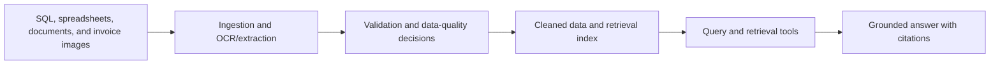
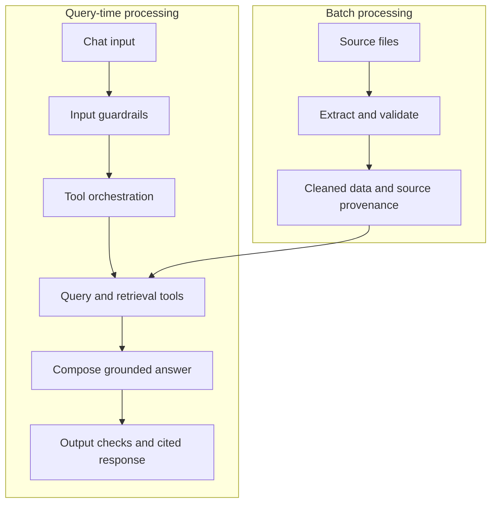

# Architecture

**Workstream:** D
**Status:** Overall application proposal; document services implemented and
tested separately. Other application layers remain proposals.

Record the proposal, decisions, and final design. Replace the conceptual diagrams
below with the verified implementation and retain at least two Mermaid diagrams.

## Data flow proposal

## Batch versus query-time proposal

## Decisions

| Date | Decision | Alternatives | Rationale | Workstream | Status |
|---|---|---|---|---|---|

## Final design

TODO: Record actual components, storage, interfaces, deployment, dependency
failures, security boundaries, and differences from the proposal.

### Implemented document subsystem

See [document_processing.md](document_processing.md) for the deployed service
design, commands, contracts, and tests. `document-ingest` is an on-demand Python
job; `document-api` is an authenticated FastAPI service; both reuse MySQL through
separate writer/reader accounts in `kaya_documents`. The existing POS database
and volume are not reset. Document services are behind a Compose profile.

The agreed implementation differs from the initial sanitized-record proposal:
original bodies and WhatsApp sender labels are returned to authenticated local
callers; email routing headers are excluded. No content is sent externally or
logged. Future assistant integration still needs output PII/policy enforcement.
Valid records from partially parsed files are published with explicit incomplete
coverage; entirely failed/missing sources retain prior records marked stale.
This subsystem only retrieves evidence and is read-only for callers; it cannot
perform consequential business actions. This does not decide the scope of
future assistant actions.

See [sequence.md](sequence.md), [schema_contract.md](schema_contract.md), and
[guardrails.md](guardrails.md).

## Implementation acceptance criteria

These are requirements, not claims about the current implementation.

- [ ] Use the class-provided LLM API endpoint; use no other paid AI services.
- [ ] Ingest SQL, tabular files, images, and documents from the supplied package.
- [ ] Use retrieval and pipelines, not raw data pasted into a startup mega-prompt.
- [ ] Compute every answer fact/figure from SQL, retrieval, or calculation tools
  called at question time; do not rely on model memory.
- [ ] Join cross-source evidence in code, including SQL, spreadsheets, and scanned
  invoices; document join keys and calculations.
- [ ] Cite supporting tables, files, or images. Disclose conflicting sources,
  which source is trusted, and why. Say when evidence cannot answer a question.
- [ ] Enforce input refusals and output PII/policy checks in code.
- [ ] Catch tool exceptions without crashing the app. Define timeouts, bounded
  retries, and justified fallbacks; never replace unavailable evidence with guesses.
- [ ] Preserve follow-up context and persist sessions across restarts/crashes.
- [ ] Log tool calls, latency, and token usage for every request, with replayable
  traces and per-request cost evidence. Keep logs free of secrets and exposed PII.

| Requirement above | Implementation/module reference | Test/evidence reference | Verification date | Status |
|---|---|---|---|---|

## Conversation state and recovery

- Session identity and isolation: TODO.
- Persisted state and checkpointer/storage: TODO.
- Follow-up resolution (for example, "and what about last month?"): TODO.
- Restart/crash recovery and failure behavior: TODO.
- Demonstration and test references: TODO; record results in [hostile_test.md](hostile_test.md).

## Human-in-the-loop scope decision

TODO: List actions with real-world consequences. For each in-scope action,
document the approval gate, approved/rejected flow, and demo evidence. If none
are in scope, explicitly state that the assistant is read-only and why no gate
is needed. Do not treat this undecided template as an out-of-scope decision.

| Action | In scope? | Approval mechanism or exclusion rationale | Implementation | Demo/test evidence |
|---|---|---|---|---|

## Observability and replay

TODO: Specify request/trace IDs, sanitized log storage, tool calls, latency,
token usage, cost calculation, and retention/access controls. Record the command
to replay a request and identify which layer failed. Link one request's trace
in [first_answer_trace.md](first_answer_trace.md) and reconcile cumulative costs
in [budget.md](budget.md).

## Requirement and milestone evidence map

The root [CHECKPOINTS.md](../CHECKPOINTS.md) remains the completion-status
authority. These links identify where evidence must be recorded, not completion.

| Source/milestone | Required outcome | Evidence location |
|---|---|---|
| Week 1 - 5 Nov 2026 | Every source opened and counted; cleaned ER diagram; evidenced traps; architecture proposal | [Data audit](data_audit.md), [ER diagram](er_diagram.md), [trap list](trap_list.md), this document |
| Week 1 - 5 Nov 2026 | Every member has committed at least once | Contribution table below |
| Week 2 - 14 Nov 2026 | Ingestion/retrieval on at least two source types, including images; OCR; cited answer; budget checked | [Data audit](data_audit.md), [invoice audit](invoice_audit.md), [answer traces](first_answer_trace.md), [budget](budget.md) |
| Week 3 - final sprint 20 Nov 2026 | Query-time cross-source tools; coded guardrails; at least 20 passing evals; hostile rehearsal | [Sequence](sequence.md), [guardrails](guardrails.md), [hostile tests](hostile_test.md) |
| Week 3 - final sprint 20 Nov 2026 | Finished one-page DQ report and timed pitch | [DQ report](dq_report.md), [pitch](pitch.md) |
| Demo - 21 Nov 2026 | Working app; five-minute pitch; separate five-minute live demo; unscripted Q&A | [Pitch and demo plan](pitch.md), [answer traces](first_answer_trace.md), [hostile tests](hostile_test.md) |
| Client brief - final scope | All four source types, provided API only, grounded cited answers, missing/conflicting-data handling, data protection | Acceptance criteria above, [data audit](data_audit.md), [guardrails](guardrails.md) |
| Harness 1-2 | Question-time grounding, code joins, three cited answers including a conflict | [Sequence](sequence.md), [answer traces](first_answer_trace.md) |
| Harness 3-4 | Coded guardrails, five kill-shot phrasings, honest failure handling | [Guardrails](guardrails.md), [hostile tests](hostile_test.md) |
| Harness 5-6 | Persistent conversation; gated consequential actions or explicit exclusion | State and approval sections above; [hostile tests](hostile_test.md) |
| Harness 7-8 | Request logs/replay, weekly spend, one-command evals and committed results | Observability section above, [budget](budget.md), [hostile tests](hostile_test.md) |

### Contribution evidence

Use team role labels and commit references; avoid personal contact details.
Include every team member, regardless of workstream or document assignment.

| Team member/role | First substantive commit reference | Contribution | Verified date |
|---|---|---|---|
