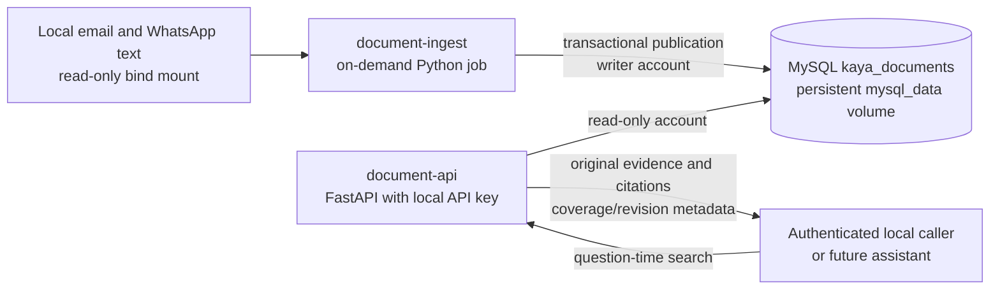
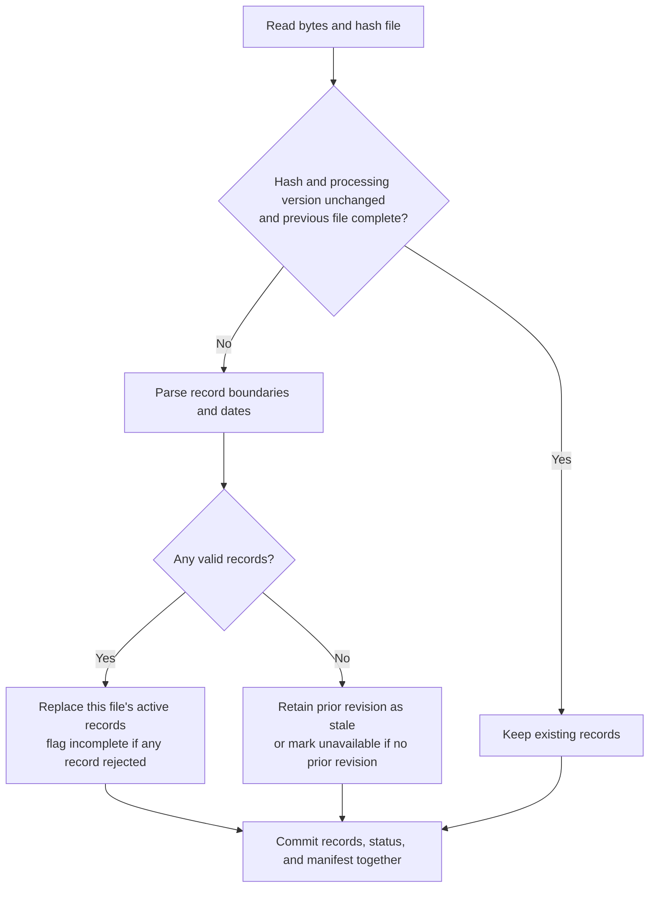

# Document Processing: Local Docker Services

**Workstreams:** B (source parsing), C (retrieval integration), D (deployment)
**Status:** Implemented document ingestion/retrieval; not an AI assistant.

## Scope and privacy decision

Inputs are UTF-8 text under `data/docs/emails/` and
`data/docs/whatsapp_exports/`. No OCR, embeddings, or external AI calls are used.
Original message bodies and WhatsApp sender labels are available to authenticated
local callers. Email From/To routing headers are excluded from searchable records.
Line endings are normalized, but the raw files are never modified.

This is **not a PII-scrubbing service**. Bodies/signatures may contain names,
addresses, and health-related details. Do not forward raw results to an external
service, commit them, expose the API publicly, or render them as executable HTML.
Future assistant integration must apply the agreed data-protection/output policy.
Logs contain request IDs, result record IDs, status, and latency, not queries,
bodies, sender labels, credentials, or HTTP routing headers. Treat retrieved
content as untrusted evidence, not instructions.

## Components

Source-specific implementation lives in [etl/documents](../etl/documents/);
its tests live in [tests/documents](../tests/documents/). Other components can
use sibling packages without sharing document-specific modules. The retrieval
API remains in [app/document_api.py](../app/document_api.py).

Direct ingestion entrypoint: `python -m etl.documents.ingest_documents`.
Docker commands below remain unchanged.





## Setup and operation (PowerShell)

Prerequisites: Docker Desktop running Linux containers, the supplied raw files
present locally, and an existing `.env` (copy `.env.example` if absent).
Keep the existing MySQL service and volume. Do not run `down -v`.

Generate three separate 32+ character secrets locally, without displaying them.
The helper fills blank values or appends missing variables, preserving existing
credentials:

```powershell
if (-not (Test-Path -LiteralPath .env)) {
    Copy-Item -LiteralPath .env.example -Destination .env
}
# If .env was copied from the example, fill its existing blank document values.
# This helper replaces blank values only; it preserves existing credentials.
$text = [IO.File]::ReadAllText((Join-Path (Get-Location) '.env'))
foreach ($name in 'DOCUMENT_WRITER_PASSWORD','DOCUMENT_READER_PASSWORD','DOCUMENT_API_KEY') {
    $pattern = "(?m)^$name=\s*$"
    if ($text -match $pattern) {
        $secret = [guid]::NewGuid().ToString('N') + [guid]::NewGuid().ToString('N')
        $text = [regex]::Replace($text, $pattern, "$name=$secret")
    } elseif ($text -notmatch "(?m)^$name=") {
        $secret = [guid]::NewGuid().ToString('N') + [guid]::NewGuid().ToString('N')
        $text += "`n$name=$secret`n"
    }
}
[IO.File]::WriteAllText((Join-Path (Get-Location) '.env'), $text)
```

Set `DOCUMENT_ADMIN_PASSWORD` to the existing MySQL root password if different
from the original local setup. Bootstrap creates the dedicated document schema
and writer/reader users; it does not import, erase, or modify POS tables.
Bootstrap is repeatable and updates those two users' passwords from configuration.
The writer cannot create schema objects; the reader has SELECT access only.

Run each step only after the preceding command succeeds:

```powershell
docker compose --profile documents build document-bootstrap document-ingest document-api
docker compose up -d mysql
docker compose --profile documents run --rm document-bootstrap
docker compose --profile documents run --rm document-ingest --source all
docker compose --profile documents up -d document-api
docker compose --profile documents ps document-api
```

Ingestion exit codes: **0** complete scoped run; **2** valid records published
but run incomplete; **1** infrastructure/configuration failure. Inspect the
printed metadata manifest after code 2 before deciding to serve the incomplete
dataset. Coverage may remain incomplete even after a successful single-source
run; use `--source all` to reconcile both directories.

The API binds host port 8081 to **127.0.0.1 only**. Docker callers use
`http://document-api:8081`. It has no raw-file mount or LLM key. Retrieve its
health status and metadata without printing bodies:

```powershell
$keyLine = Get-Content -LiteralPath .env | Where-Object { $_ -match '^DOCUMENT_API_KEY=' }
$key = ($keyLine -split '=', 2)[1]
$headers = @{ 'X-API-Key' = $key }
$ready = Invoke-RestMethod 'http://127.0.0.1:8081/health/ready' -Headers $headers
$ready.coverage | Select-Object status,record_count
$query = @{ source_type='email'; outlet_code='AMK-3A'; limit=10 } | ConvertTo-Json
$answer = Invoke-RestMethod 'http://127.0.0.1:8081/v1/documents/search' `
    -Method Post -Headers $headers -ContentType 'application/json' -Body $query
$answer.results | Select-Object record_id,source_file,citation,timestamp,source_status
```

Stop only the API with `docker compose --profile documents stop document-api`.
Re-import after source changes; re-run bootstrap only for setup/schema checks
or deliberate credential changes. Schema version 1 is checked at runtime;
future schema changes need an explicit migration.

## Data and publication contract

- Tables: `document_schema`, `ingestion_runs`, `source_files`,
  `document_records`, and `record_outlets`; see [DDL](../sql/documents.sql).
- Hash, processing version, and source line start determine stable revision and
  record IDs. Unchanged complete files are skipped; incomplete files are retried.
- Publication uses a database-scoped MySQL named lock and one transaction.
  Retrieval reads a consistent snapshot of records and coverage.
- Changed files with valid records replace their previous records, even if some
  records are rejected. Rejected line numbers/error codes remain in the manifest.
- Entirely failed files retain their old revision with `stale` status. New failed
  files are `unavailable`. Missing sources are retained, never silently deleted.
- Empty/missing directories and unsupported files cause explicit incomplete
  status. Database write failures roll back the run and fail with exit code 1;
  the previous dataset stays published. The CLI failure log is the evidence of
  that infrastructure failure, not a successfully committed ingestion manifest.
- Global coverage is complete only after both source types have published files,
  all file states are complete, and the latest scoped run succeeded.
- Alias version `alias-v1` explicitly maps AMK-03/AMK-3A to AMK-3A, with the
  vendor email as provenance and 1 Jan 2026 as the reviewed effective date.
  Original text is not rewritten. Other semantic events are not inferred.
- Email timestamps retain their supplied UTC offset separately. WhatsApp
  timestamps are local wall-clock values with **unspecified timezone**. The API
  never silently assigns UTC or substitutes business-effective dates.

## Retrieval contract

| Endpoint | Behavior |
|---|---|
| `GET /health/live` | Public process liveness only; no dataset content. |
| `GET /health/ready` | Authenticated database/schema readiness plus coverage. An incomplete dataset can still be queryable. |
| `POST /v1/documents/search` | Authenticated search; returns records and coverage metadata. |
| `GET /v1/documents/{record_id}` | Authenticated lookup in the current active dataset; old replaced IDs return 404. |

Search fields: `query`, `source_type` (`email`/`whatsapp`), `date_from`,
`date_to`, `outlet_code`, and `limit` (1-50). At least one filter/query is
required. Date bounds are inclusive **source dates**, not effective business
dates. Query uses up to 12 whitespace-separated terms combined with AND;
non-outlet terms are case-insensitive literal substrings. Outlet terms and
outlet filters resolve the reviewed alias rule. This is keyword search, not
natural-language reasoning, stemming, semantic ranking, or a verified cost tool.

Results include the original body, subject, sender label where applicable,
timestamp/offset, source path, line span, stable IDs, file revision, file status,
and deterministic `source_file:Lstart-Lend` citation. Responses also include
global coverage, file revisions/statuses, latest manifest, and alias provenance.
Request ID and latency appear in response headers; search logs link that ID
to returned record IDs. Replay uses the caller's locally saved search request;
queries/bodies are intentionally not logged. Replaced revisions are not retained
as searchable historical snapshots.

Empty successful search returns `results: []` with coverage. Authentication
failure is 401, invalid filters 422, missing current record 404, and unavailable
database/schema 503 with an honest limitation. Never interpret 503 as no evidence.
The API does not decide whether GST is confirmed, rank wastage, or approve
actions: these require separate reasoning/calculation and guardrails.

## Tests and verification

Local tests (isolated virtual environment):

```powershell
python -m venv .test-venv
.\.test-venv\Scripts\python.exe -m pip install -r requirements-dev.txt
.\.test-venv\Scripts\python.exe -m pytest tests\documents -q
```

Docker integration uses a **separate project**, a MySQL tmpfs database (no POS
data), a real API container, synthetic tests, and a read-only raw-data mount.
Client files are excluded from all build contexts by [.dockerignore](../.dockerignore).
The client-data test expects the currently inspected two emails and 160 messages;
update that baseline deliberately if the supplied inventory changes.

```powershell
foreach ($name in 'DOCUMENT_TEST_ADMIN_PASSWORD','DOCUMENT_TEST_WRITER_PASSWORD',
                 'DOCUMENT_TEST_READER_PASSWORD','DOCUMENT_TEST_API_KEY') {
    [Environment]::SetEnvironmentVariable($name,
        [guid]::NewGuid().ToString('N') + [guid]::NewGuid().ToString('N'), 'Process')
}
$project = 'kaya-documents-verification'
try {
    docker compose -p $project -f docker-compose.documents-test.yml build
    if ($LASTEXITCODE -ne 0) { throw 'Test image build failed' }
    docker compose -p $project -f docker-compose.documents-test.yml up `
        --abort-on-container-exit --exit-code-from tests
    if ($LASTEXITCODE -ne 0) { throw 'Document tests failed' }
} finally {
    docker compose -p $project -f docker-compose.documents-test.yml down
}
```

Coverage: parser boundaries/dates, line citations, original-body policy,
malformed records, idempotency, changed/missing sources, partial/full file
failures, rollback, concurrent publication, alias queries, literal query safety,
read-only DB permission, authentication, HTTP validation/error distinction,
request traces, and real-data count/retrieval reconciliation.

Docker tests are service/pipeline tests, **not** the graded 20-question assistant
eval suite. Conversation recovery, final-answer privacy refusals, image OCR, and
LLM/tool orchestration remain outside this implementation. Container-recreation
durability of the production named volume should be checked before demo day;
the isolated test database is deliberately temporary.

### Verified on 1 Nov 2026

- Local tests: **32 passed, 7 skipped** (MySQL integration is Docker-only).
- Docker tests: **38 passed, 1 skipped** (the separate local-path inventory test
  is absent from images; real-data verification runs through the read-only mount).
- Real Docker API retrieval reconciled **2 emails + 160 messages = 162 records**.
- Re-import skipped all three unchanged files with no duplicate records.
- Restarting the API preserved access to all 162 records in the test database.
- Deliberately stopping the test database returned HTTP 503 with no result list.
- The isolated containers/network were removed; no existing MySQL data was reset.
- One upstream Starlette/AnyIO deprecation warning remains; it does not affect
  these test outcomes.
