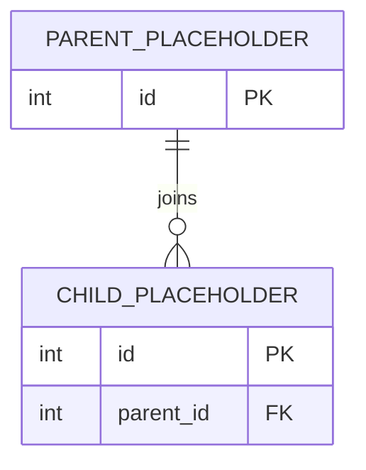
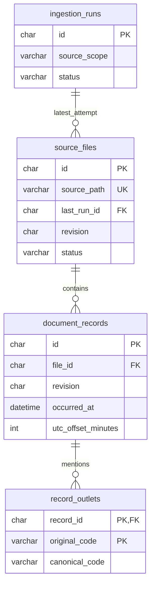

# Cleaned Schema ER Diagram

**Workstream:** A
**Status:** Template - cleaned schema not yet agreed.

Show the cleaned tables, primary and foreign keys, join columns, and
cardinalities. Keep names aligned with [schema_contract.md](schema_contract.md).

## Diagram

The entities below are placeholders, not actual schema names. Replace them with
the verified cleaned schema before review.

## Join rules and exceptions

TODO: Document join keys, unmatched records, nullable relationships, and any
relationships that cannot be enforced as foreign keys.

## Implemented document subsystem (not the cleaned POS schema)

The placeholder above still needs replacement for the full cleaned schema.
This separate diagram reflects [sql/documents.sql](../sql/documents.sql).

