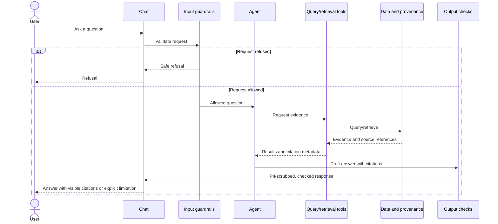

# Question-to-Answer Sequence

**Workstream:** C
**Status:** Proposed flow - validate against the working application.

Trace one question from chat input through guardrails, tools, source citations,
and the final answer.

## Verified example

TODO: Record a non-sensitive question, tools called, citation format, failure
behavior, and implementation references. Link the first successful trace in
[first_answer_trace.md](first_answer_trace.md).

## Question-time grounding evidence

- [ ] Every fact/figure is supported by a tool call made for this question.
- [ ] Cross-source joins and calculations are performed by code, not inferred
  by the model from unrelated retrieved fragments.
- [ ] Missing evidence produces an explicit limitation, not an invented answer.
- [ ] Conflicts disclose the competing sources, trusted source, and rationale.

| Step/tool | Tool definition reference | Question-time call/trace ID | Source references | Code join/calculation | Supported claim/citation |
|---|---|---|---|---|---|

TODO: Link a hard cross-source question trace and its verified numerical
expectations. Include state restoration, error, and approval branches in the
diagram when the implementation requires them.
